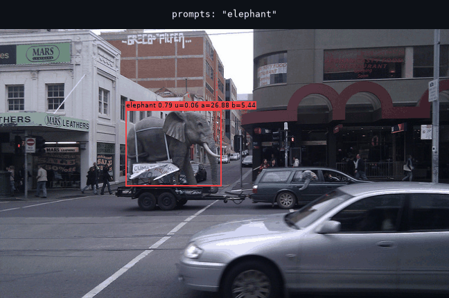

<div align="center">

# E-DETR: Evidential Detection Transformers

[](LICENSE)
[](pyproject.toml)
[](https://pytorch.org)
[](https://pixi.sh)



<sub>VLM-EDETR detecting open-vocabulary prompts. Each label shows the score, the uncertainty
<code>u</code> and the Beta parameters <code>a</code> (α) and <code>b</code> (β).<br>
Photo: <a href="https://www.flickr.com/photos/andersondotcom/4911867169/">"The Elephant in the election
turned out to be a Hung Parliament"</a> by Gavin Anderson,
<a href="https://creativecommons.org/licenses/by-sa/2.0/">CC BY-SA 2.0</a>; the animation is
shared under the same license.</sub>

</div>

---

## Quick start

```bash
git clone https://github.com/thisistejaspandey/e-detr.git && cd e-detr
pixi install
```

| task | command |
|---|---|
| 🖼️ Detect your own prompts | `pixi run notebook` |
| 🏋️ Train VLM-EDETR | `pixi run train configs/vlm_edetr_lvis.yaml` |
| 🔍 Run on LVIS val + AP | `pixi run infer configs/vlm_edetr_lvis.yaml weights/vlm_edetr_lvis.pth` |
| 🔤 Build LVIS text embeddings | `pixi run text-embeddings data/lvis/lvis_v1_val.json weights/lvis_text_embeddings_rn50.pt` |
| ⚡ E-DETR example | `pixi run quickstart --weights rtdetr_r50vd_6x_coco_from_paddle.pth` |

## Data format

```
data/coco/{train2017,val2017}/        # COCO 2017 images
data/lvis/lvis_v1_{train,val}.json    # https://www.lvisdataset.org/dataset
```

## Checkpoints

| model | download |
|---|---|
| VLM-EDETR (OV-LVIS, CLIP RN50) | _coming soon_ |

> [!NOTE]
> Put downloaded weights in `weights/`.

## License

Apache 2.0. See [`LICENSE`](LICENSE) and [`NOTICE`](NOTICE). Parts of the model code are
adapted from [RT-DETR](https://github.com/lyuwenyu/RT-DETR) (Apache 2.0).
